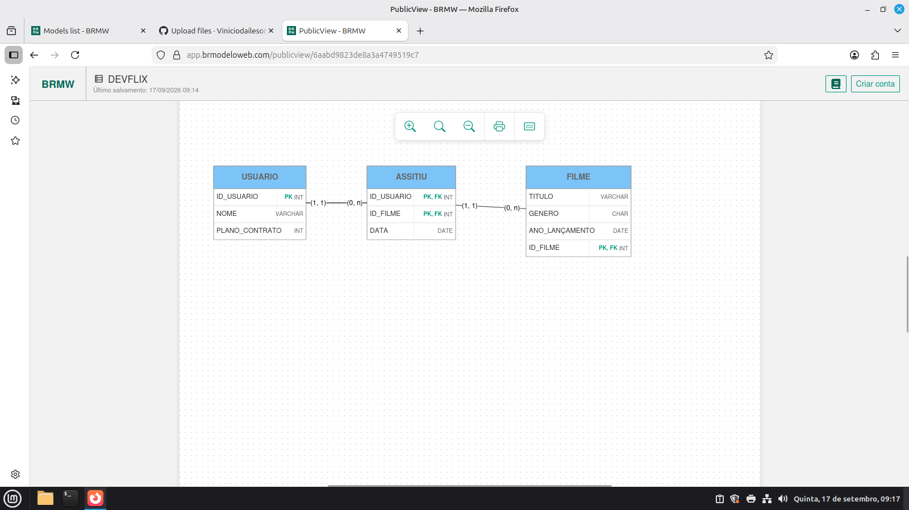

# Modelo lógico do banco de dados — DEVFLIX

Diagrama do modelo lógico de um sistema de filmes/streaming, criado no [BRModelo Web](https://app.brmodeloweb.com/).

## Entidades

- **USUARIO** — pessoas cadastradas no sistema (nome e plano contratado).
- **FILME** — filmes disponíveis (título, gênero, ano de lançamento).
- **ASSISTIU** — tabela associativa que registra qual usuário assistiu a qual filme e em que data.

## Relacionamentos

- Um usuário pode assistir a vários filmes (1,N).
- Um filme pode ser assistido por vários usuários (0,N).
- O relacionamento muitos-para-muitos é resolvido pela tabela `ASSISTIU`, cuja chave primária é composta por `ID_USUARIO` + `ID_FILME`.

O script para criar as tabelas está em [`modelo-logico.sql`](modelo-logico.sql).
